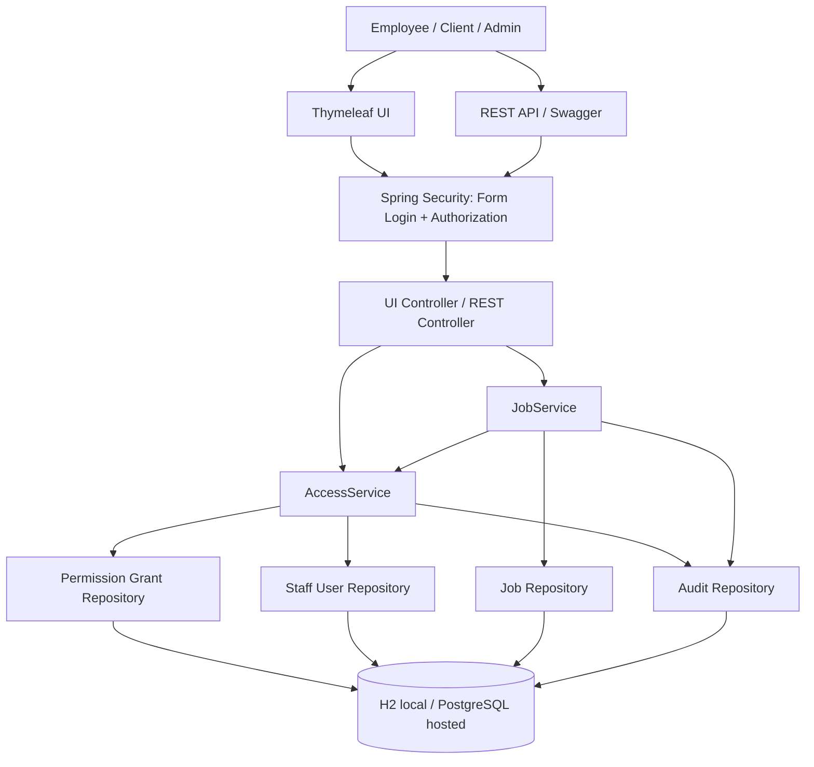

# NFPL Access Control — architecture

## Main browser routes
- `/login`: Spring Security form login
- `/dashboard`: visible-job summary and current account status
- `/jobs`: visible jobs and workflow action forms
- `/access-check`: action authorization with reason code and explanation
- `/admin/audit`: admin-only audit log
- `/admin/grants-ui`: admin-only users and grants overview, plus absence toggle

## Request flow
1. Spring Security authenticates the user.
2. A controller receives a page or API request.
3. `AccessService` evaluates user status, grants, scope, job stage, and maker/checker separation.
4. The service returns an allow/deny decision with a reason.
5. Access checks and completed workflow transitions are recorded in `AuditEvent`.

The diagram represents the intended logical design. The project remains an assignment prototype and needs the production hardening items listed in `README.md`.
